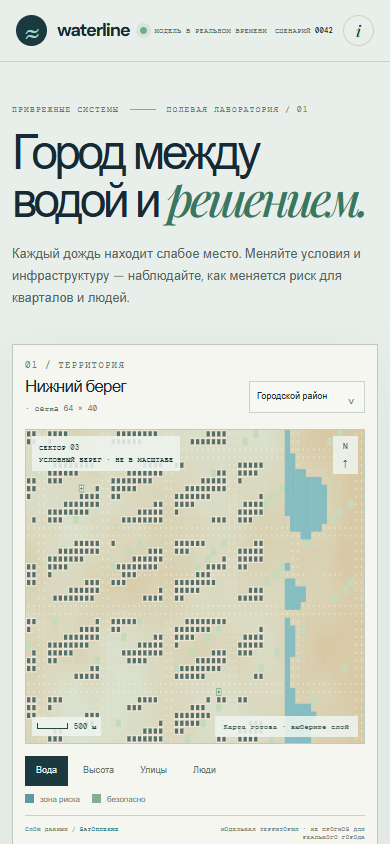

# Waterline

## English

**A scenario workshop for testing choices in a fictional coastal district.** Waterline lets a class, design team, or community group see how rainfall, tide, terrain, and local interventions can change exposure across one generated neighborhood.

The model is intentionally comparative: save a completed baseline, reset the same map, place measures such as rain gardens or barriers, run again, and export a short Markdown brief with both outcomes and their conditions.

## Run

Open `index.html` in a modern browser, or serve this folder with any static web server. No account or server-side data storage is required.

## What it does

- Generates a repeatable fictional coastal district from a seed.
- Compares rainfall and tide conditions across map scales.
- Lets you place pumps, rain gardens, and barriers, then inspect changing flood and shelter-route layers.
- Tracks risk to residents, buildings, roads, and routes while the scenario runs.
- Saves a baseline, compares a second run, and exports a Markdown scenario brief.

## Scope

Waterline is a learning and discussion tool. Its simplified simulation is not a flood forecast, evacuation guide, or substitute for local hazard data.

## Русский

**Waterline — мастерская сценариев для условного прибрежного района.** Класс, проектная команда или местное сообщество могут посмотреть, как дождь, прилив, рельеф и защитные меры меняют риски на одной и той же карте.

Сначала завершите исходный прогон и сохраните его. Затем сбросьте ту же карту, разместите меры вроде дождевых садов или защитных валов и запустите сценарий повторно. Результаты и условия можно скачать в виде заметки Markdown.

### Запуск

Откройте `index.html` в современном браузере или запустите любой статический веб-сервер в этой папке. Аккаунт и серверное хранение данных не нужны.

### Возможности

- Создание повторяемого условного прибрежного района по seed.
- Настройка дождя и прилива для участков разного масштаба.
- Размещение насосов, дождевых садов и защитных валов с просмотром слоёв затопления и маршрутов к укрытиям.
- Отслеживание риска для жителей, зданий, дорог и маршрутов по ходу прогона.
- Сохранение исходного результата, сравнение второго прогона и экспорт заметки Markdown.

### Ограничения

Waterline предназначен для обучения и обсуждения сценариев. Упрощённая модель не является прогнозом наводнения, инструкцией по эвакуации или заменой местным данным об опасности.
